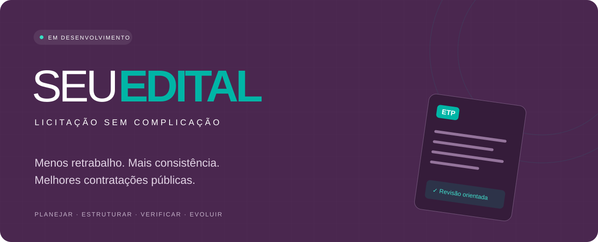
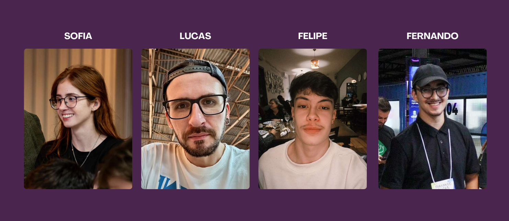

**Planejar com clareza. Construir com orientação. Avançar com consistência.**

`Em desenvolvimento` · `Compras públicas` · `ETP e TR` · `Validação em andamento`

[Conheça a proposta](#02--nossa-proposta-de-valor) · [Explore a jornada](#03--como-a-solução-funciona) · [Próximos passos](#09--próximos-passos)

---

# SEUEDITAL
### Inteligência para transformar o planejamento das compras públicas.

**Menos retrabalho. Mais consistência. Melhores contratações públicas.**

O SEUEDITAL é uma solução tecnológica em desenvolvimento que busca melhorar a maneira como órgãos públicos planejam suas contratações.

Nossa proposta é ajudar servidores a elaborar, organizar e verificar documentos essenciais dos processos licitatórios, identificando possíveis erros e inconsistências antes que eles se transformem em retrabalho, atrasos ou problemas nas etapas seguintes.

O projeto nasceu da investigação de dificuldades enfrentadas por profissionais envolvidos em compras públicas e evoluiu durante competições de inovação no Paraná.

**2º lugar no Super Hackathon Cascavel | 3º lugar no Super Hackathon Foz do Iguaçu**

**Status: Em desenvolvimento e evolução para aceleração.**

---

# 01 — Por que o SEUEDITAL existe?

## O problema não é apenas preencher documentos.

Antes de uma contratação pública acontecer, existe uma etapa fundamental: o planejamento.

É nesse momento que a administração precisa identificar sua necessidade, definir o objeto, justificar a contratação, estimar custos e preparar documentos como o Estudo Técnico Preliminar (ETP) e o Termo de Referência (TR).

Esses documentos sustentam decisões administrativas e precisam reunir informações técnicas, jurídicas e econômicas coerentes.

**Mas existe um problema: produzir um documento não significa que ele está pronto para avançar.**

Na prática, podem ocorrer situações como:

- Informações obrigatórias ausentes ou incompletas.
- Divergências entre documentos do mesmo processo.
- Descrições de produtos ou serviços insuficientes.
- Pesquisas de preços com referências pouco comparáveis.
- Documentos que precisam retornar para ajustes.
- Servidores gastando tempo revisando informações que poderiam ter sido verificadas anteriormente.

### O resultado

Um processo que deveria avançar pode retornar para correções, exigindo novas análises, alterações e validações.

Isso consome tempo dos profissionais e pode aumentar o prazo necessário para realizar uma contratação.

O SEUEDITAL foi concebido para atuar justamente nessa etapa anterior ao problema.

> **Nossa hipótese:** parte significativa do retrabalho documental pode ser evitada com orientação estruturada, verificações preventivas e melhor organização das informações.

Essa hipótese deverá ser validada por meio de testes com profissionais e processos reais.

---

# 02 — Nossa proposta de valor

## Identificar problemas antes que eles avancem.

O SEUEDITAL busca transformar a elaboração documental em um processo orientado, verificável e mais consistente.

Em vez de oferecer apenas um editor para preencher documentos, nossa proposta combina três capacidades:

**1. Orientar a construção**

Ajudar o servidor a estruturar documentos de planejamento com maior clareza sobre as informações necessárias.

**2. Verificar a consistência**

Analisar documentos para apontar possíveis omissões, contradições e requisitos que necessitam de revisão.

**3. Apoiar decisões com dados**

Organizar referências de compras públicas e contribuir para pesquisas de preços mais fundamentadas.

### O valor que pretendemos entregar

| Para quem | Valor esperado |
|---|---|
| Servidor responsável pelo planejamento | Mais orientação e menos trabalho repetitivo |
| Setor de compras e licitações | Documentos mais organizados e consistentes |
| Equipe de análise jurídica | Menos problemas documentais básicos para revisão |
| Gestores públicos | Maior visibilidade sobre pendências do planejamento |
| Administração pública | Potencial redução de retrabalho e atrasos |

**Não queremos automatizar a responsabilidade do servidor. Queremos oferecer melhores instrumentos para que ele possa exercê-la.**

---

# 03 — Como a solução funciona?

O SEUEDITAL é concebido como um ambiente que acompanha a preparação dos documentos e ajuda a identificar pontos que precisam de atenção.

### Jornada proposta

**Etapa 01 — Entender a necessidade**

O servidor informa o que a administração pretende contratar e organiza as informações essenciais.

↓

**Etapa 02 — Estruturar a documentação**

A plataforma orienta a elaboração dos documentos de planejamento, especialmente ETP e TR.

↓

**Etapa 03 — Fundamentar a estimativa de preços**

O sistema busca apoiar a identificação e organização de referências para comparação de preços.

↓

**Etapa 04 — Verificar o conteúdo**

As informações passam por verificações de completude, consistência e requisitos previamente definidos.

↓

**Etapa 05 — Identificar pendências**

O servidor visualiza os pontos que exigem correção, complementação ou validação.

↓

**Etapa 06 — Revisar e prosseguir**

Após as correções e validações necessárias, os documentos podem ser encaminhados às etapas administrativas pertinentes.

*Este fluxo representa a experiência de produto proposta, não uma declaração de que todas as etapas já estejam implementadas.*

---

# 04 — O que estamos construindo?

A solução está organizada em quatro frentes de desenvolvimento.

## Construtor inteligente de ETP e TR

**O desafio:** elaborar documentos complexos sem esquecer informações importantes ou produzir conteúdo inconsistente.

**Nossa abordagem:** oferecer uma experiência orientada para estruturar as informações exigidas no planejamento.

Capacidades previstas:

- Estruturas para ETP e TR.
- Orientação durante o preenchimento.
- Organização de requisitos e justificativas.
- Identificação de campos e seções incompletas.
- Padronização de informações.

**Valor esperado:** facilitar a elaboração e reduzir problemas de organização documental.

## Verificação preventiva

**O desafio:** inconsistências podem ser percebidas apenas quando o processo chega a uma etapa posterior de revisão.

**Nossa abordagem:** verificar o conteúdo antecipadamente, com critérios que permitam explicar por que uma informação precisa de atenção.

Capacidades previstas:

- Identificação de possíveis omissões.
- Verificação de coerência entre informações.
- Conferência de requisitos documentais.
- Identificação de pontos que exigem avaliação humana.
- Referências às normas aplicáveis.

**Valor esperado:** encontrar problemas mais cedo, quando corrigi-los pode exigir menos esforço.

## Inteligência para pesquisa de preços

**O desafio:** encontrar preços não é suficiente. É necessário avaliar se os itens e condições utilizados como referência são realmente comparáveis.

**Nossa abordagem:** apoiar a organização das fontes de preços e a análise das características dos itens.

Capacidades previstas:

- Uso de referências públicas de contratações.
- Classificação e identificação de materiais e serviços.
- Comparação de características e unidades.
- Organização de evidências.
- Análises estatísticas de apoio.

**Valor esperado:** contribuir para estimativas mais justificáveis e transparentes.

## Raio-X do processo

**O desafio:** compreender rapidamente o que está correto, o que falta e o que precisa ser corrigido.

**Nossa abordagem:** consolidar as verificações em uma visão simples das pendências do processo.

Capacidades previstas:

- Visão consolidada do estado documental.
- Pendências e inconsistências identificadas.
- Evidências e referências disponíveis.
- Pontos que necessitam de validação.
- Ações sugeridas para revisão.

**Valor esperado:** tornar a revisão documental mais clara e orientada.

---

# 05 — O que torna o SEUEDITAL diferente?

## Não queremos apenas digitalizar a burocracia.

A diferença central está no momento em que queremos atuar.

Muitos fluxos de trabalho concentram esforços na elaboração de arquivos, na movimentação dos processos ou na análise posterior da documentação.

O SEUEDITAL busca integrar orientação e verificação à própria preparação dos documentos.

| Abordagem convencional | Abordagem proposta pelo SEUEDITAL |
|---|---|
| Preencher modelos de documentos | Construção orientada |
| Identificar falhas em revisões posteriores | Verificações durante a elaboração |
| Pesquisar referências separadamente | Pesquisa integrada ao planejamento |
| Conferir documentos individualmente | Visão consolidada de pendências |
| Realizar correções após devoluções | Priorizar a prevenção de inconsistências |

Essas diferenças representam o posicionamento pretendido para o produto. Não significam que outras plataformas sejam incapazes de oferecer funcionalidades semelhantes.

### Nossa principal premissa

**O melhor momento para corrigir um problema é antes que ele se propague pelo processo.**

---

# 06 — Quem queremos atender?

Nosso público inicial são os profissionais e setores diretamente envolvidos no planejamento das contratações públicas, especialmente em administrações municipais.

**Usuários principais**

- Servidores que elaboram ETP e TR.
- Equipes de planejamento de contratações.
- Setores de compras e licitações.

**Públicos envolvidos**

- Assessorias jurídicas.
- Gestores administrativos.
- Unidades requisitantes.
- Profissionais responsáveis pela conferência e fiscalização dos procedimentos.

O foco inicial está na melhoria do trabalho operacional de planejamento, sem substituir decisões e responsabilidades legalmente atribuídas a esses profissionais.

---

# 07 — Origem e trajetória do projeto

## Da identificação do problema à construção de uma solução.

O SEUEDITAL surgiu a partir do interesse em compreender dificuldades reais enfrentadas no planejamento de compras públicas.

Durante a investigação do problema, a equipe direcionou a proposta para situações em que o retrabalho e a falta de consistência documental podem comprometer a eficiência administrativa.

Essa oportunidade deu origem ao desenvolvimento do projeto durante eventos de inovação.

### Nossa trajetória

**Identificação do problema**

Investigação das dificuldades relacionadas à elaboração e revisão dos documentos de planejamento.

**Super Hackathon Cascavel — 2º lugar**

Desenvolvimento e apresentação da proposta de solução durante a competição.

**Super Hackathon Foz do Iguaçu — 3º lugar**

Continuidade da participação da equipe e reconhecimento do projeto.

**Próxima etapa — Aceleração**

Evolução da proposta, aprofundamento da validação do problema e amadurecimento do produto.

As premiações representam reconhecimento em competições. Ainda não constituem comprovação de resultados operacionais ou financeiros em órgãos públicos.

---

# 08 — Em que fase estamos?

## Desenvolvimento e validação.

O SEUEDITAL não é apresentado como um produto comercial consolidado.

Estamos em uma fase de evolução da solução e investigação de sua aplicação em ambientes reais.

### Nossa posição atual

| Dimensão | Situação |
|---|---|
| Problema central | Identificado |
| Proposta de valor | Definida |
| Participação em hackathons | Realizada |
| Reconhecimento em competições | 2º e 3º lugares |
| Evolução para aceleração | Em andamento |
| Validação quantitativa de impacto | Pendente |
| Disponibilidade comercial | Não informada |

### O que precisamos comprovar?

Nossa prioridade é transformar uma hipótese de valor em evidência mensurável.

Para isso, pretendemos investigar:

1. Quanto tempo os servidores levam para elaborar documentos?
2. Quais inconsistências provocam mais correções?
3. Quantas dessas inconsistências poderiam ser identificadas antecipadamente?
4. Quanto retrabalho pode ser evitado?
5. Em quais situações a plataforma realmente facilita o trabalho?

A validação dessas perguntas é fundamental para decidir quais funcionalidades devem receber prioridade.

---

# 09 — Próximos passos

Nossa evolução está organizada em quatro objetivos.

### Objetivo 1 — Validar o problema

Aprofundar conversas com servidores e profissionais envolvidos em contratações públicas, identificando dificuldades frequentes e mensuráveis.

### Objetivo 2 — Consolidar o produto

Priorizar as funcionalidades que resolvem os problemas mais relevantes e estruturar uma experiência de utilização coerente.

### Objetivo 3 — Testar em situações reais

Avaliar a solução com documentos e fluxos representativos, respeitando as exigências legais e a proteção das informações envolvidas.

### Objetivo 4 — Comprovar o valor

Comparar resultados e medir indicadores como tempo de elaboração, inconsistências identificadas e esforço de correção.

**Nosso critério de sucesso não será a quantidade de funcionalidades desenvolvidas, mas o valor efetivamente demonstrado para os profissionais que utilizam a solução.**

---

# 10 — Tecnologia, legislação e responsabilidade

O projeto considera a Lei Federal nº 14.133/2021 como uma das principais referências normativas para as contratações públicas.

As regras aplicáveis, entretanto, podem variar conforme a natureza da contratação, as regulamentações locais e outras normas pertinentes.

As verificações tecnológicas propostas não substituem análise jurídica, aprovação administrativa, julgamento profissional ou demais competências legalmente estabelecidas.

### Fontes oficiais de referência

- [Lei Federal nº 14.133/2021](https://www.planalto.gov.br/ccivil_03/_ato2019-2022/2021/lei/l14133.htm)
- [Portal Nacional de Contratações Públicas — PNCP](https://pncp.gov.br/)
- [Compras.gov.br](https://www.gov.br/compras/pt-br)

A arquitetura técnica, as integrações implementadas e os detalhes de desenvolvimento poderão ser apresentados em documentação específica do repositório.

---

# 11 — Equipe SEUEDITAL

O projeto é resultado do trabalho da equipe **SEUEDITAL**, participante dos Super Hackathons de Cascavel e Foz do Iguaçu.

A equipe atua no desenvolvimento da proposta, na investigação do problema e na evolução tecnológica da solução.

**Reconhecimentos:**

- 2º lugar — Super Hackathon Cascavel.
- 3º lugar — Super Hackathon Foz do Iguaçu.

**Projeto em evolução para etapa de aceleração.**

**Sofia · Lucas · Felipe · Fernando**

---

# 12 — Nossa visão

A transformação digital das compras públicas não deve se limitar à troca de papéis por formulários eletrônicos.

Existe uma oportunidade de utilizar tecnologia para ajudar profissionais a produzir informações mais confiáveis, identificar problemas com antecedência e melhorar a qualidade das decisões administrativas.

É nessa oportunidade que o SEUEDITAL pretende atuar.

Não buscamos retirar o servidor do processo. Buscamos reduzir o esforço dedicado a problemas repetitivos para que mais atenção possa ser direcionada ao que realmente exige conhecimento, análise e responsabilidade.

### SEUEDITAL

**Porque uma contratação pública melhor começa muito antes da publicação do edital.**
